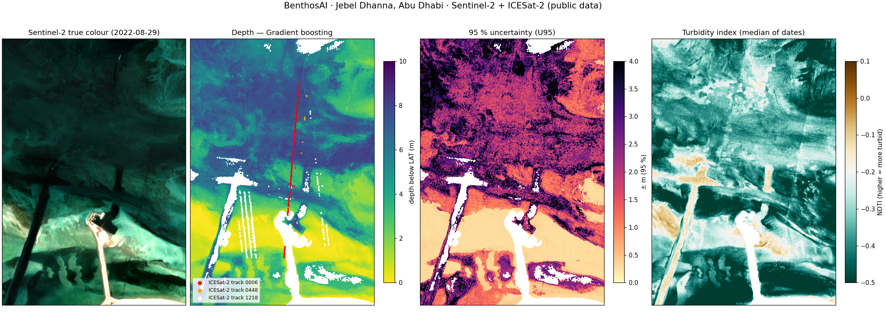
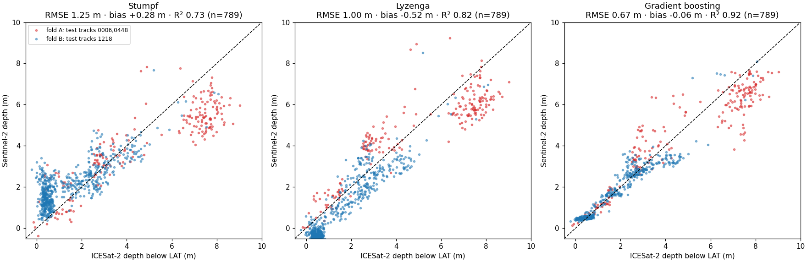

# BenthosAI — Seabed Depth and Water Clarity from Space

**Team:** BenthosAI · **Entry by:** Abu Dhabi Maritime Academy (AD Ports Group) · **Country:** United Arab Emirates · **Theme:** Water Quality & Inland/Coastal Water Intelligence

**One line:** BenthosAI turns free Sentinel-2 images and NASA ICESat-2 laser depths into a dated depth map with a
95 % uncertainty for every pixel, a turbidity (water-clarity) map and an IHO S-44 accuracy grade, in minutes, for any
clear coastal water.



---

## 1. Business use case

**Users:**
- port authorities and harbour masters;
- national hydrographic offices;
- dredging contractors;
- coastal and environmental agencies.

**Decisions they make:**
- where to send a survey vessel first;
- whether a channel or berth has silted up;
- where water is too turbid for work or for habitats;
- which areas of an old nautical chart need re-surveying.

**What they use today:** vessel-based multibeam or single-beam surveys, and charts that are often decades old in
shallow areas. A vessel survey is accurate but slow (days to weeks), expensive and cannot safely enter very shallow water.

**What BenthosAI adds:** a fast, low-cost first look from space.
- **Where depth can be trusted:** a depth map with its own 95 % uncertainty.
- **How the water is:** a turbidity map.
- **What to do next:** an S-44 grade showing where a vessel survey is still needed.

The user can then plan surveys, monitor change between surveys, and screen large coastlines quickly.

## 2. The problem

- **The risky water is the least surveyed water.** Shallow coastal water is where ships are most at risk and
  habitats are most sensitive. It is also the hardest and most expensive water to survey: boats cannot easily reach
  it, and seabeds there change after storms and dredging.
- **Charts are out of date.** Around the world, large parts of coastal waters have never been surveyed to modern
  standards, or not for decades.
- **Satellites can fill the gap.** Satellites see every coast every few days.
  - Sentinel-2 revisits every ~5 days at 10 m, free of charge.
  - In clear water its colour carries depth information down to about 10–12 m.
  - ICESat-2's green laser measures true depths along its tracks, free of charge.
  - Combined, the two give calibrated depths with no boat at all.
- **What is still missing:** an honest error estimate per pixel and a clear signal of where the water is too turbid
  or too deep to trust. BenthosAI is built around both.

## 3. Data used

| Dataset | Provider | Product / level | Dates | Licence |
|---|---|---|---|---|
| Sentinel-2 MSI | ESA Copernicus, via Microsoft Planetary Computer | Level-2A surface reflectance (bands B01–B05, B08, B11, SCL), tile T39QXG | 2022-08-29, 2022-09-03, 2022-09-23 | Copernicus open licence (free, attribution: "Contains modified Copernicus Sentinel data 2022") |
| ICESat-2 ATL24 | NASA / NSIDC DAAC | Coastal and nearshore bathymetry photons (ATL24), aggregated to 10 m pixels | 7 passes, 2019-09-15 → 2023-06-09, tracks 1218, 0006, 0448 | NASA open data, no restrictions |
| EOT20 tide model | DGFI-TUM | Global ocean tide model, used to reduce laser depths to LAT | n/a | CC BY 4.0 |

Exact scene IDs are listed in `data/sample_input/s2_scenes.json` and the laser granules in
`data/sample_input/icesat2_atl24_jebel_dhanna.csv`. **Hyperspectral data are not used in this PoC.** EnMAP / PRISMA
are planned next, to separate seabed type, chlorophyll and sediment (see §9).

**Confidential training data (not in this repository).** Our production model (pipeline v1.4.3) is trained and
validated on about 240,000 high-order multibeam soundings at 7 Abu Dhabi sites, provided by AD Ports Group. These
soundings and the model trained on them are confidential and are **not** shared here. Their internal results are
summarised in §8 for context only. Everything a reviewer runs in this repository uses public data.

## 4. Technical approach (in execution order)

1. **Load** three Sentinel-2 L2A clips (10 m study area of 4 × 5.8 km, plus a 60 m context box of 17 km) and the ICESat-2 depths.
2. **Reflectance:** DN → reflectance with ESA's −1000 offset for processing baseline ≥ 4.0.
3. **Masks:** clouds and shadows from the scene classification (grown by 50 m); water where NDWI > 0 and B11 < 0.06.
4. **Deep-water reference and sun-glint:** the darkest 20 % of water in the context box gives the deep-water
   reflectance ρ∞. Glint is removed against B11 when R² ≥ 0.3 (Hedley et al., 2005).
5. **Water quality:**
   - NDTI turbidity index = (red − green)/(red + green) (Lacaux et al., 2007);
   - red-edge (B05) turbidity signal;
   - "seabed visible" test: signal-to-noise ≥ 3, otherwise the pixel is optically deep.
6. **Depth features:** Stumpf log-ratio ln(1000·blue)/ln(1000·green) (Stumpf et al., 2003) and Lyzenga
   X_i = ln(R_i − ρ∞,i) for B01–B04 (Lyzenga, 1978).
7. **Reference depths:** ICESat-2 pixels with ≥ 3 photons, confidence ≥ 0.6 and spread ≤ 0.5 m. Depth below LAT =
   laser depth − EOT20 tide at the pass time.
8. **Leak-free, cross-track validation:** ICESat-2 repeats the same ground track, so splitting by date would leak
   neighbouring pixels. Two folds swap the roles of the three tracks:
   - fold A trains on track 1218 and tests on tracks 0006 + 0448;
   - fold B trains on 0006 + 0448 and tests on 1218.

   Test pixels within 100 m of any training pixel are dropped, so every laser pixel is predicted by models that
   never saw its track.
9. **Three models, calibrated per image date:**
   - Stumpf (Huber line, the classical baseline);
   - Lyzenga (Huber multiple regression);
   - gradient boosting (scikit-learn `HistGradientBoostingRegressor`, depth-balanced weights).

   Calibrating each date separately absorbs that date's tide level and water colour.
10. **Fusion and uncertainty:**
    - the dates are fused with inverse-error weights;
    - σ = weighted spread between dates;
    - U95 = q_band·(σ + γ), with q_band set by split-conformal calibration per depth band. Within each fold it is
      learned on the training tracks; for the final map it is learned on the cross-track errors.
11. **Validation on the cross-track predictions:** RMSE, MAE, bias, R², error by depth band, U95 coverage, and the share
    inside IHO S-44 (6th ed.) TVU for Special Order, Order 1a/1b and Order 2.
12. **Final map:** models re-fitted on all tracks. **Outputs:** maps (PNG), a 4-band GeoTIFF (depth, U95, NDTI, flag), metrics tables and a JSON run summary.

## 5. Installation

Requires **Python 3.11**.

```bash
git clone https://github.com/saeed491/BenthosAI-SDB
cd BenthosAI-SDB
python -m venv .venv
source .venv/bin/activate          # Windows: .venv\Scripts\activate
pip install -r requirements.txt
```

No API keys or accounts are needed. The sample data are in the repository.

## 6. How to run

```bash
jupyter lab notebooks/02_main_analysis.ipynb
```

Run all cells (Kernel → Restart Kernel and Run All Cells). Runtime is **under one minute** (about 25 s) on a standard laptop, with
no GPU. The same run, without opening Jupyter:

```bash
jupyter nbconvert --to notebook --execute notebooks/02_main_analysis.ipynb --output 02_main_analysis.ipynb
```

- **Reads:** `data/sample_input/` (three Sentinel-2 clips and the ICESat-2 CSV).
- **Writes:** everything in `results/`.
- **Settings:** all in the `CFG` dictionary in the first code cell.
- **New site:** edit the scene IDs and bounding boxes in `scripts/download_sample.py`, run it, and replace the
  ICESat-2 CSV for the new area.

**Re-downloading the Sentinel-2 sample** (optional, free, no account):

```bash
python scripts/download_sample.py
```

## 7. Example input and output

**Input** (`data/sample_input/`):
- `S2_2022MMDD_aoi10m.tif`: Sentinel-2 L2A bands B01 B02 B03 B04 B05 B08 B11 SCL, 10 m, 400 × 580 px, EPSG:32639.
- `S2_2022MMDD_ctx60m.tif`: the same bands at 60 m for the 17 km context box.
- `icesat2_atl24_jebel_dhanna.csv`: 844 ICESat-2 pixels with laser depth, tide and depth below LAT.
- `s2_scenes.json`: the exact scene IDs, dates and processing baseline.

**Output** (`results/`):

| File | Content |
|---|---|
| `example_output.png` | true colour, depth, 95 % uncertainty and turbidity maps with the laser tracks (shown above) |
| `validation_scatter.png` | predicted vs ICESat-2 depth, cross-track, for the three models |
| `metrics_cross_track.csv`, `metrics_by_fold.csv`, `metrics_by_depth_band.csv` | accuracy tables |
| `depth_uncertainty_turbidity.tif` | GeoTIFF: depth below LAT, U95, NDTI, quality flag |
| `water_quality_summary.csv` | turbidity, seabed visibility and red-edge signal per date |
| `run_summary.json` | scene IDs, best model and headline metrics |



## 8. Results and limitations

### Reproducible result (this repository, public data only)

Test: **789 ICESat-2 pixels, each predicted by models trained only on the other tracks** (two-fold cross-track validation), depth range ≈0–10 m.

| Model | n | RMSE (m) | MAE (m) | Bias (m) | R² | S-44 Order 2 | S-44 Order 1a/1b | S-44 Special | U95 coverage | Median U95 (m) |
|---|---|---|---|---|---|---|---|---|---|---|
| Stumpf | 789 | 1.25 | 1.00 | +0.28 | 0.73 | 59 % | 29 % | 15 % | 99 % | 4.05 |
| Lyzenga | 789 | 1.00 | 0.86 | -0.52 | 0.82 | 67 % | 25 % | 11 % | 90 % | 1.93 |
| **Gradient boosting** | 789 | **0.67** | 0.42 | -0.06 | 0.92 | 86 % | 74 % | 56 % | 97 % | 1.18 |

**Headline:** the Gradient boosting model maps depth with **RMSE 0.67 m** (bias -0.06 m, R² 0.92) on laser tracks it never saw, against 1.25 m for the classical Stumpf baseline. 86 % of test points fall within the IHO S-44 Order 2 tolerance, and the 95 % uncertainty band contains 97 % of the test depths. The run covers 96 % of the clear water with a depth; the rest is flagged.

Error by depth band (Gradient boosting): 0–2 m: RMSE 0.20 m, bias +0.09 m (n = 431); 2–5 m: RMSE 0.77 m, bias +0.10 m (n = 243); 5–12 m: RMSE 1.29 m, bias -0.97 m (n = 115).

By fold (Gradient boosting): fold A (test tracks 0006,0448, n = 207): RMSE 1.11 m, bias -0.28 m, S-44 Order 2 63 %; fold B (test tracks 1218, n = 582): RMSE 0.41 m, bias +0.02 m, S-44 Order 2 95 %. Fold A tests on deeper water, which is harder.

### Internal validation of the production model (confidential data, for context only)

Our production model (pipeline v1.4.3) was validated on confidential AD Ports Group multibeam surveys
(≈240,000 soundings, 7 Abu Dhabi sites, whole sites held out for testing, depths reduced to LAT with tide gauges and
EOT20). Indicative internal results:

- **Khalifa Port 2021, local calibration:** RMSE 0.26 m · S-44 Order 2: 99.8 % · Order 1a/1b: 95.8 %.
- **All map methods, depths < 12 m (38,345 points):** RMSE 0.85 m · MAE 0.57 m · bias −0.02 m.
- **ICESat-2 vs multibeam survey (Jebel Dhanna):** 0.50 m RMSE → 0.25 m after a vertical-offset correction.
  This is why the public PoC can use ICESat-2 as a stand-in for a survey.

These figures cannot be reproduced from this repository, because the soundings are confidential. The trained model is
not published, and is available to the evaluation committee on request.

### Limitations

- **Depth reach.** Optical depth only works where the seabed is visible: about 10–12 m in clear Gulf water, less
  in turbid water. Optically deep and turbid pixels are flagged, not guessed.
- **Time gap.** The laser passes span 2019–2023, while the images are from Aug–Sep 2022. Dredging at Jebel Dhanna
  adds real seabed change to the measured error.
- **Reference uncertainty.** ICESat-2 depths (≈ 0.2–0.5 m) and the global EOT20 tide add their own uncertainty, so
  the test is against satellite laser data, not a certified survey.
- **Small test.** There is one site and three laser tracks; fold A, with deeper water, is harder than fold B (see `metrics_by_fold.csv`). Results elsewhere will differ with water clarity and seabed type.
- **Not for navigation.** This is a planning and monitoring tool, not a hydrographic survey.

## 9. Next steps

- **Hyperspectral:** EnMAP and PRISMA bands to separate seabed type, chlorophyll and suspended sediment, and to
  push the depth limit in moderately turbid water.
- **More sites:** a time series of depth and turbidity change for dredging and siltation monitoring.
- **Simple web app:** draw an area → depth, uncertainty and turbidity maps (a desktop prototype exists).
- **Hydrographic pilot:** grading against IHO S-44 with port and hydrographic partners.

## 10. Team, licence and attribution

**Team BenthosAI, Abu Dhabi Maritime Academy (AD Ports Group), UAE:**

| Name | Role |
|---|---|
| Dr Muhammad Saeed (team lead) | SDB pipeline, model and validation; repository owner |
| Akram Habib | Faculty co-lead: port use case, review and approvals |
| Meera Alqubaisi | Reproducibility testing (fresh install and notebook run) |
| Mansour Alketbi | Presentation, PDF export and demo video |
| Mayed Abdulla | Submission checklist, platform form and hyperspectral next step |

**Licence:** BenthosAI Evaluation Licence, all rights reserved (see `LICENSE`). You may view and run the code to evaluate or reproduce this submission; any other use, including commercial use or redistribution, needs our written permission. No patent licence is granted.

**Data:**
- Contains modified Copernicus Sentinel data (2022), accessed via Microsoft Planetary Computer.
- NASA ICESat-2 ATL24 via NSIDC DAAC.
- EOT20 tide model (Hart-Davis et al., 2021, CC BY 4.0).

**Methods credited:**
- Stumpf et al. (2003), *Limnology & Oceanography* 48(1);
- Lyzenga (1978), *Applied Optics* 17(3);
- Hedley et al. (2005), *Int. J. Remote Sensing* 26(10);
- Lacaux et al. (2007), *Remote Sensing of Environment* 106;
- Vovk et al. (2005), *Algorithmic Learning in a Random World*;
- IHO S-44 (6th edition, 2020).

The method builds on the BenthosAI team's own satellite-derived bathymetry pipeline (v1.4.3).
